<div align="center">

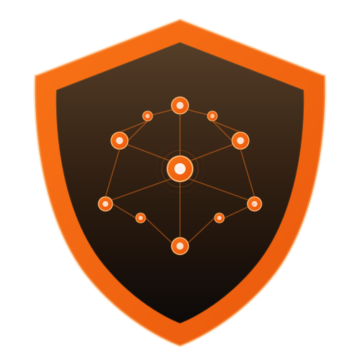

# GuardNous

### *Defend What Matters*

**Code scanning · Cloud posture · 20 AI agents with human approval for every change**

[](LICENSE)
[](https://python.org)
[](https://nextjs.org)
[](https://fastapi.tiangolo.com)
[](docker-compose.yml)
[](CONTRIBUTING.md)

[**Quickstart**](#quickstart) · [**Features**](#what-it-does) · [**Architecture**](#architecture) · [**Documentation**](#documentation) · [**Website**](https://guardnous.github.io)

<br/>


</div>

---

GuardNous is a self-hosted, open-source security platform that does three things:

1. **Code and IaC scanning.** It runs the scanners you already trust (Semgrep, Trivy, Checkov,
   tfsec, Gitleaks) on your repositories, puts their results in one format, and gives your team
   one place to triage, assign and track findings.
2. **Cloud posture.** It connects to a live AWS account without access keys, reads its
   configuration, and checks it against 44 rules (19 mapped to CIS AWS Foundations v1.4.0).
   Azure and Google Cloud accounts can be connected and inventoried; posture rules are AWS-only today.
3. **AI agents that act, with approval.** 20 agents with 72 tools answer questions from your real
   data, open fix pull requests, post to Slack and fix cloud misconfigurations. Anything that
   changes something stops and waits for a person to approve the exact change.

> **Not another scanner.** GuardNous does not re-invent static analysis. It unifies the results,
> adds cloud posture and an agent layer, and wraps them in team workflow: roles and permissions,
> multi-tenancy, SLA deadlines, SBOM export, compliance mapping, two-factor sign-in and PDF reports.

## Quickstart

You need Docker with Compose 2.24 or newer.

```bash
git clone https://github.com/guardnous/guardnous.git
cd guardnous
./scripts/setup.sh
```

The script generates the secret keys, builds the images, runs the database migrations and starts
all 6 services. The first build downloads the scanners and takes several minutes.

At the end it prints the address, **http://localhost:7003**, and the administrator login:
`admin@guardnous.com` with a **generated password, shown once**. There is no default password.

| Service | Address |
|---|---|
| Dashboard | http://localhost:7003 |
| API | http://localhost:7002 |
| API documentation | http://localhost:7002/docs |

More in [Getting started](docs/getting-started.md) and [Configuration](docs/configuration.md).

## What it does

| Area | What you get | Details |
|---|---|---|
| **Scanning** | 9 scanner adapters behind one interface: Semgrep, Trivy, Checkov, tfsec, Gitleaks, plus built-in Terraform, CloudFormation, Bicep and secrets scanners. Results from any other tool come in through SARIF | [Features](docs/features.md) · [Plugins](docs/plugins.md) · [SARIF import](docs/sarif-import.md) |
| **Findings** | Triage, assignment, notes and bulk actions. Decisions are kept when a repository is scanned again. Every finding gets a remediation deadline from its severity | [Features](docs/features.md) |
| **Cloud posture** | AWS connected through OIDC federation, with no access keys stored. 44 rules, an internet-exposure view, and 5 fixes that can be rolled back | [Features](docs/features.md) |
| **AI agents** | Chat on your live data with file attachments and PDF export, and background agent runs with step and token budgets. Bring your own model: OpenAI, Azure OpenAI, Azure AI Foundry, Anthropic or a local Ollama | [Features](docs/features.md) · [AGENTS.md](AGENTS.md) · [SKILLS.md](SKILLS.md) |
| **Approval** | A fix pull request, a cloud fix or a Slack message runs only after a person approves the exact change. Changes outside GuardNous need a second person | [How it works](docs/how-it-works.md) |
| **Governance** | 6 compliance frameworks with 92 controls, a policy engine with 21 built-in policies, SBOM export in CycloneDX 1.5, and PDF reports on a schedule | [Features](docs/features.md) |
| **Teams** | Tenants, organizations and users; 72 permissions in 7 roles; two-factor sign-in; audit log. Every row is scoped to its tenant and organization | [Features](docs/features.md) |
| **Integrations** | GitHub, GitLab, Bitbucket and Azure DevOps: connect repositories, scan on push, and open fix pull requests | [Features](docs/features.md) |

What is not there yet: posture rules for Azure and Google Cloud, a supported Kubernetes
deployment (a Helm chart is included as a preview), and parallel execution of multi-agent plans.
The [roadmap](docs/roadmap.md) lists what is built and what is planned.

### What has been verified

Everything has automated tests. Not everything has been run against the real service yet:

| | Status |
|---|---|
| Install with Docker Compose, the scanners, findings and triage | ✅ Verified |
| **GitHub**: connect, scan repositories, fix pull requests | ✅ Verified |
| **AWS**: keyless connection, reading an account, the 44 rules | ✅ Verified |
| AI chat and agent runs with approval (Azure AI Foundry) | ✅ Verified |
| **GitLab, Bitbucket, Azure DevOps** | 🧪 Tested with simulated services only |
| **Azure, Google Cloud**: connect and inventory | 🧪 Tested with simulated services only |
| AWS fixes and rollback; webhooks; Slack; other model providers | 🧪 Tested with simulated services only |
| Kubernetes (Helm chart) | 🚧 Preview, not yet run on a cluster |

The full list is in [What has been verified](docs/status.md). Have access to one of the untested
services? Verifying it is a great first contribution.

## Architecture

<div align="center">
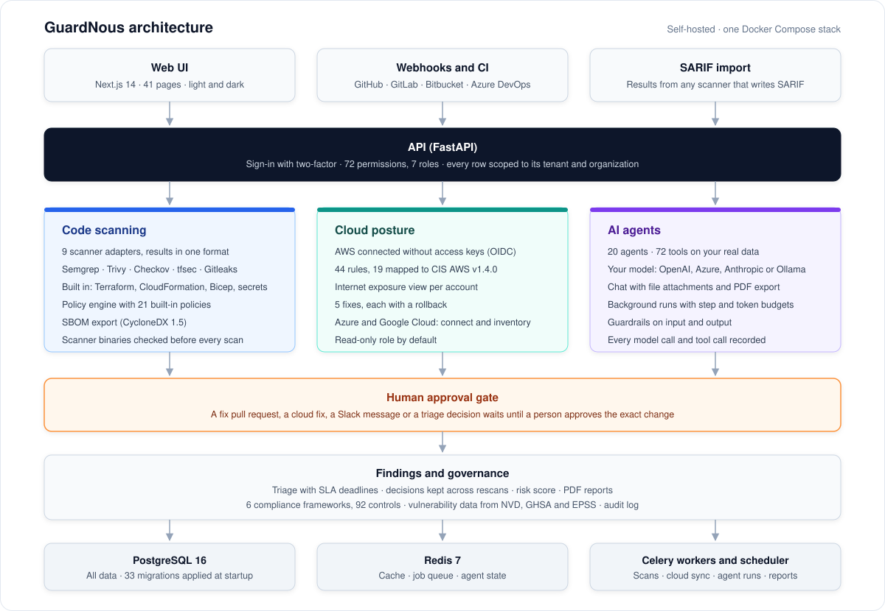
</div>

Work enters through the web UI, a webhook or a SARIF import, and passes the API, which checks
who you are and what you may do. Three engines do the work: code scanning, cloud posture and the
agents. Anything that would change something waits at the approval gate. Everything lands in one
findings and governance layer, stored in PostgreSQL, with Redis and Celery workers running the
background jobs.

The flows, the data model and the tech stack are in [How GuardNous works](docs/how-it-works.md).

## Screenshots

<details>
<summary><b>Click to expand — 22 screens of the GuardNous UI</b></summary>

| | |
|---|---|
| **1. Login** | **2. Dashboard** |
|  |  |
| **3. VCS Integrations** | **4. Assessments** |
|  |  |
| **5. Task Monitor** | **6. Findings** |
| 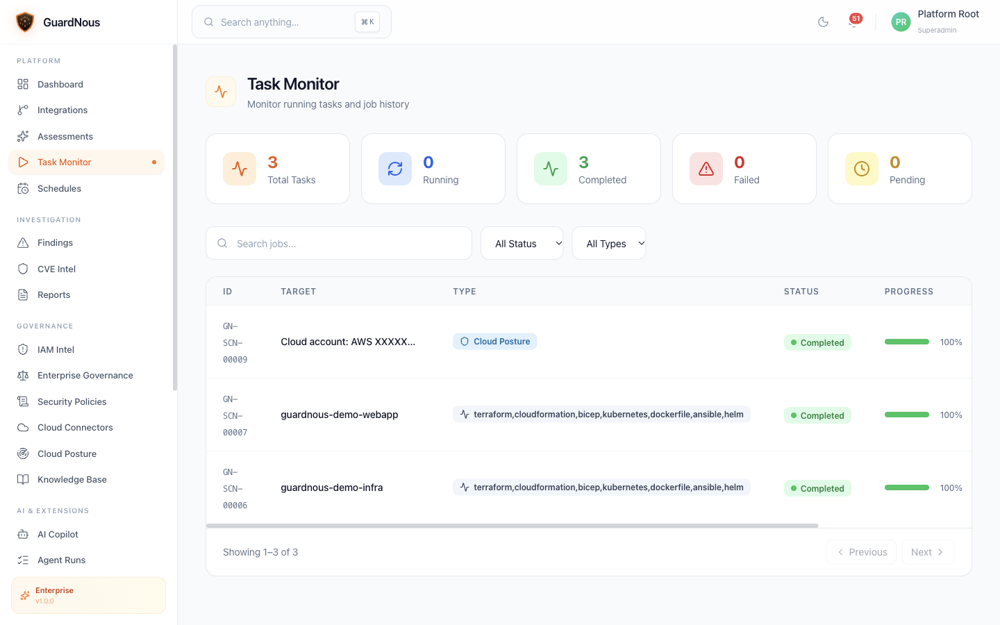 |  |
| **7. CVEs** | **8. Reports** |
|  | 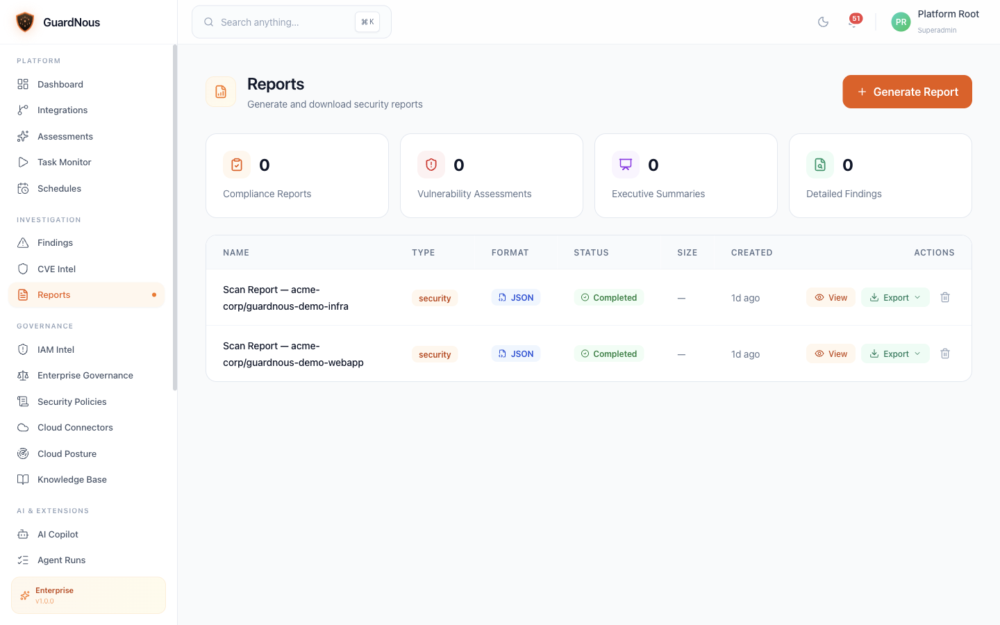 |
| **9. Cloud Connectors** | **10. Connect AWS without access keys** |
|  | 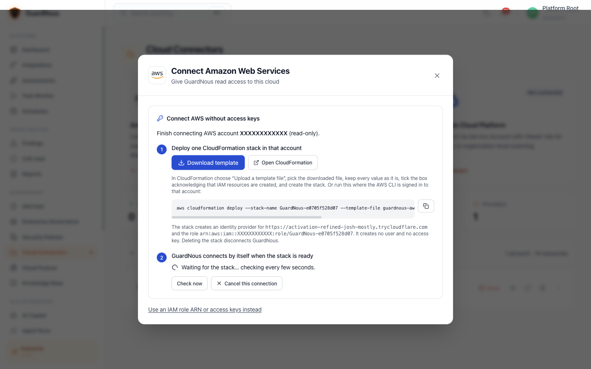 |
| **11. Cloud Posture — accounts per cloud** | **12. Cloud Posture — one account** |
|  | 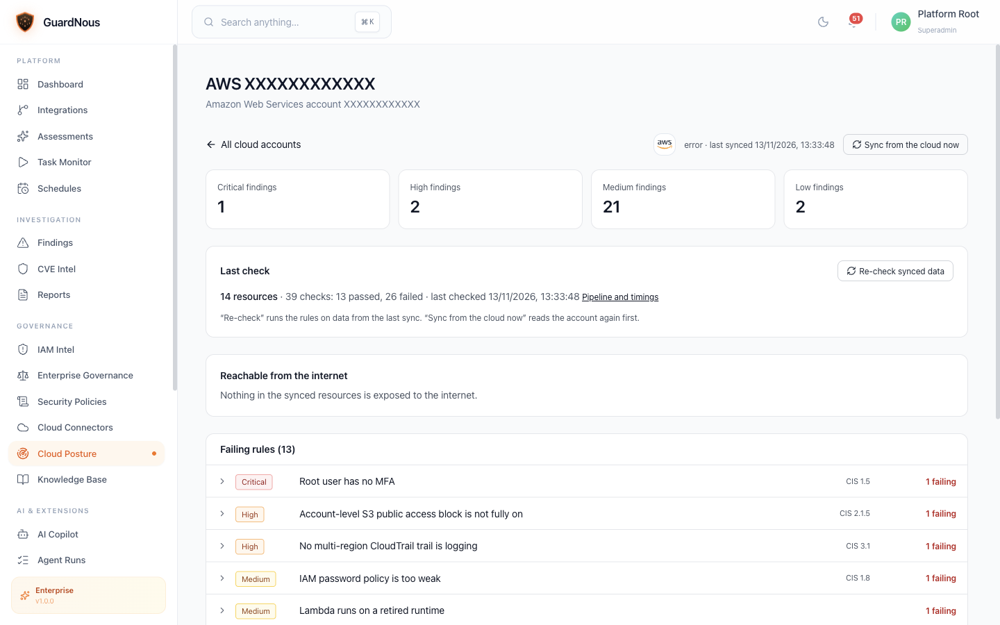 |
| **13. Cloud posture assessment pipeline** | **14. Governance** |
|  | 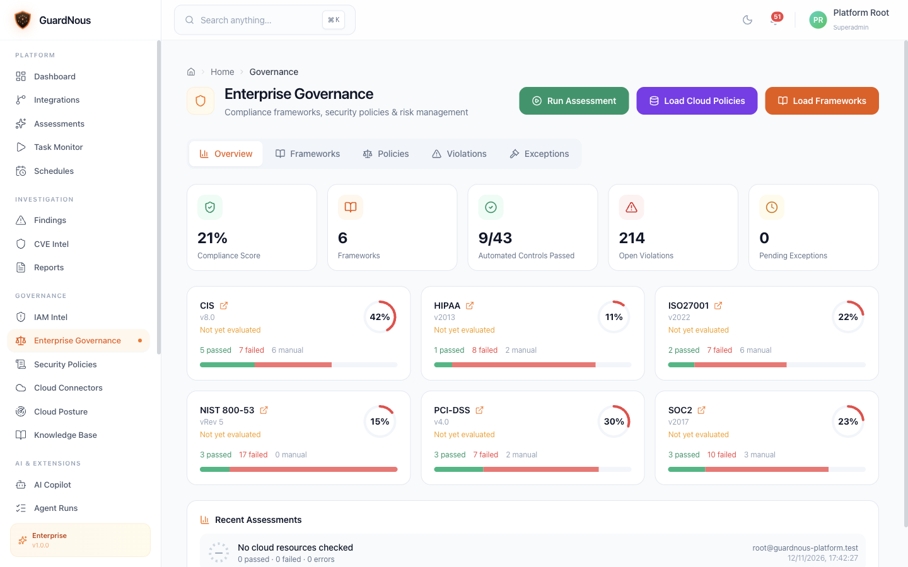 |
| **15. IAM** | **16. AI Copilot** |
|  | 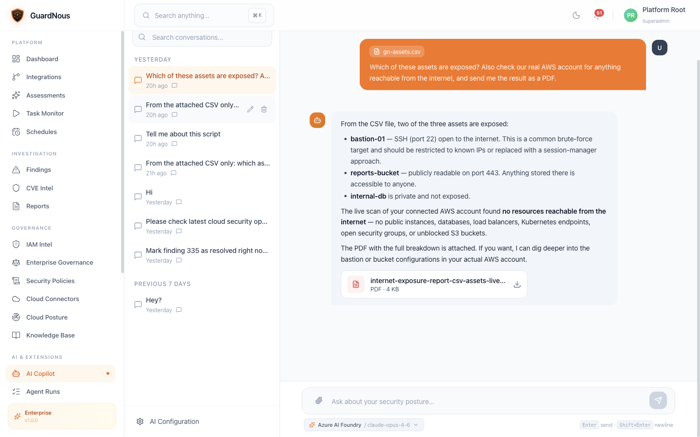 |
| **17. Agent Run — approval with the exact change** | **18. Plugins** |
| 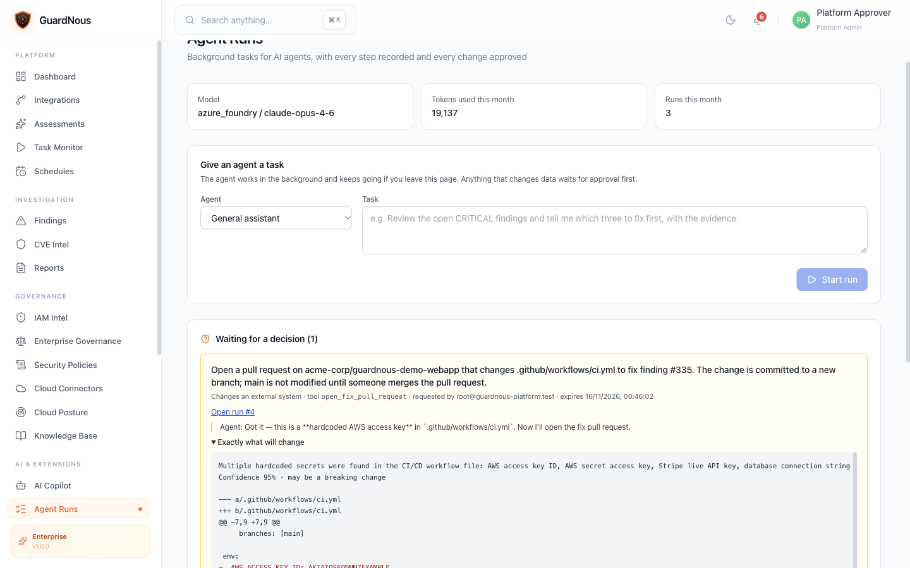 | 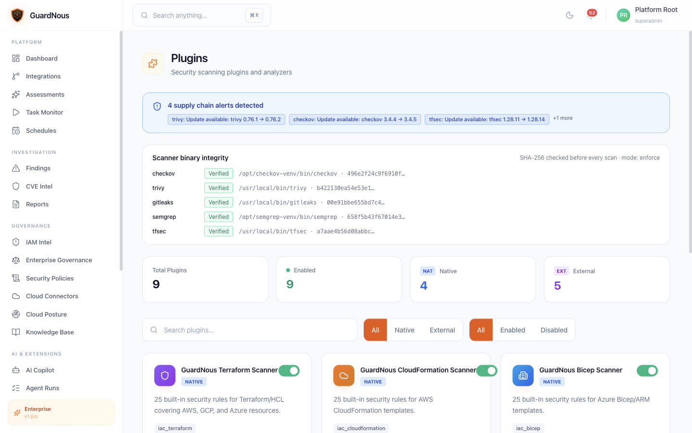 |
| **19. Settings** | **20. Admin — Users** |
|  | 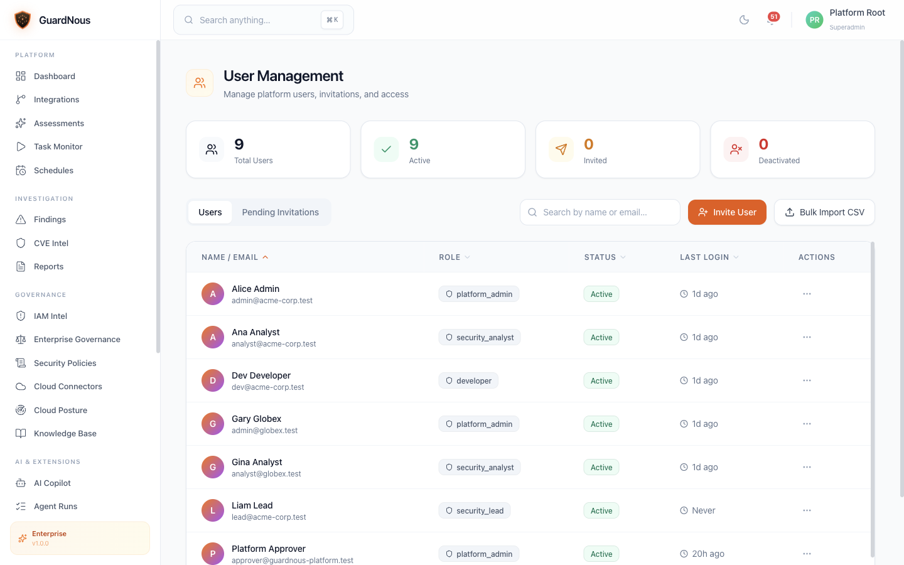 |
| **21. Admin — Roles** | **22. Admin — Audit Logs** |
| 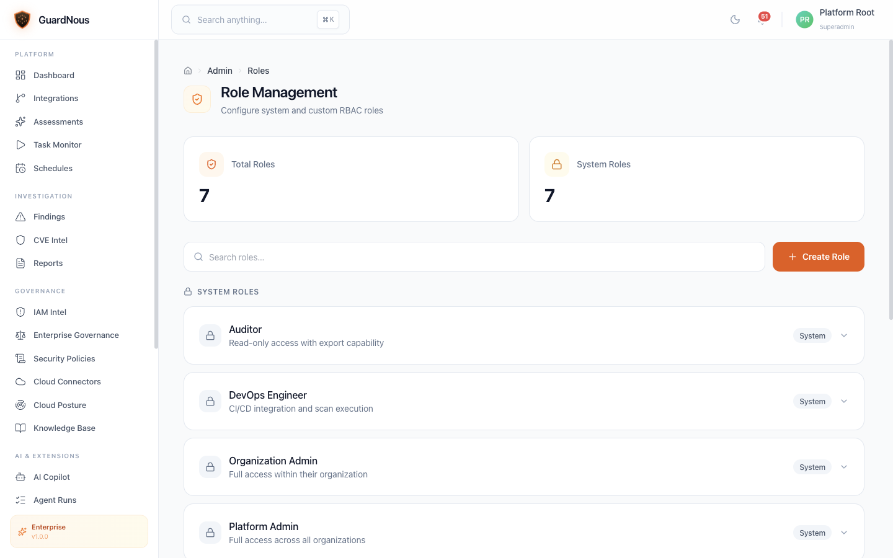 |  |

Account numbers and user names in the screenshots are masked.

</details>

## Why GuardNous

| Option | Problem |
|--------|---------|
| **Command-line scanners** (Trivy, Checkov, tfsec) | Good tools with no platform: no dashboard, no triage, no roles |
| **Commercial platforms** | Expensive, and your code and cloud data leave your network |
| **Open-source aggregators** | Collect findings, but have no cloud posture and no agents |

GuardNous sits on top of the scanners you already use, adds the team workflow, and runs entirely
on your own infrastructure. The full capability comparison is in [Why GuardNous](docs/comparison.md).

## Documentation

| Topic | Where |
|---|---|
| Install, ports, pages of the UI | [Getting started](docs/getting-started.md) |
| Every feature in detail | [Features](docs/features.md) |
| Architecture, flows, data model, tech stack | [How GuardNous works](docs/how-it-works.md) · [Component notes](docs/architecture.md) |
| Agents, tools and prompts | [AGENTS.md](AGENTS.md) · [SKILLS.md](SKILLS.md) · [PROMPTS.md](PROMPTS.md) |
| Environment variables | [Configuration](docs/configuration.md) |
| API endpoints | [API reference](docs/api.md), or `/docs` on a running instance |
| Writing a scanner adapter | [Scanner plugins](docs/plugins.md) |
| Importing results from other tools | [SARIF import](docs/sarif-import.md) |
| Docker Compose and the Kubernetes preview | [Deployment](docs/deployment.md) |
| Local development and tests | [Development](docs/development.md) · [Project structure](docs/project-structure.md) |
| How the Triage Agent is evaluated | [Triage evaluation](docs/evals/triage.md) |
| What has been run against real services | [What has been verified](docs/status.md) |
| What is built and what is planned | [Roadmap](docs/roadmap.md) · [Changelog](CHANGELOG.md) |
| Reporting a vulnerability | [SECURITY.md](SECURITY.md) |

## Contributing

Contributions are welcome. [CONTRIBUTING.md](CONTRIBUTING.md) covers setup, tests and the pull
request process, and the [Code of Conduct](CODE_OF_CONDUCT.md) applies to everyone.

Good first contributions:
- Verify an integration you have access to (GitLab, Bitbucket, Azure DevOps, Azure, Google Cloud): see [What has been verified](docs/status.md)
- A scanner adapter: one Python file, see [Scanner plugins](docs/plugins.md)
- A cloud posture rule, or controls for an existing compliance framework
- Tests

## License

[Apache License 2.0](LICENSE). Free for personal and commercial use, with a patent grant from
every contributor. By contributing you agree your contribution is licensed under the same terms.

---

<div align="center">

**GuardNous — code scanning, cloud posture and approval-gated AI agents**

[Website](https://guardnous.github.io) · [Report a bug](https://github.com/guardnous/guardnous/issues) · [Request a feature](https://github.com/guardnous/guardnous/issues)

</div>
