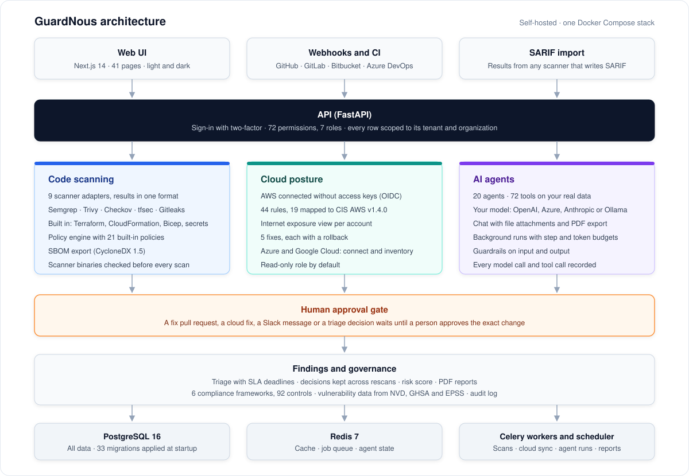

# How GuardNous works

[← Back to the README](../README.md)



The same picture in more detail, followed by the main flows, the data model and the tech stack. Component-level notes are in [architecture.md](architecture.md).

```
┌──────────────────────────────────────────────────────────────────────────┐
│                      🖥️  FRONTEND — Next.js 14                          │
│   41 pages · TailwindCSS · shadcn/ui · Org Switcher · Light + Dark     │
│   Cloud Connectors · Cloud Posture · Agent Runs + Approvals            │
│   Streaming AI Chat with attachments · Real-time Logs · E2E Tests      │
└────────────────────────────────┬─────────────────────────────────────────┘
                                 │ REST API + SSE (JWT + TOTP 2FA)
┌────────────────────────────────▼─────────────────────────────────────────┐
│                       ⚙️  BACKEND — FastAPI                              │
│                                                                          │
│  ┌──────────────┐ ┌──────────────┐ ┌──────────────┐ ┌──────────────┐    │
│  │ 🔐 Auth &    │ │ 🔌 Plugin    │ │ 📜 Policy    │ │ 🛡️ CVE Sync  │    │
│  │ Multi-Tenant │ │ Orchestrator │ │ Engine       │ │ NVD+GHSA     │    │
│  │ 72 perms     │ │ 9 adapters   │ │ 21 policies  │ │ +EPSS        │    │
│  │ 7 roles      │ │ parallel exec│ │ struct match │ │ daily sync   │    │
│  └──────────────┘ └──────────────┘ └──────────────┘ └──────────────┘    │
│                                                                          │
│  ┌──────────────┐ ┌──────────────┐ ┌──────────────┐ ┌──────────────┐    │
│  │ 📦 SBOM      │ │ 📋 Compliance│ │ 🔗 VCS       │ │ 📊 Risk      │    │
│  │ CycloneDX1.5 │ │ 6 frameworks │ │ GitHub,GitLab│ │ Scorer       │    │
│  │ 9 manifests  │ │ 92 controls  │ │ BB, AzDO     │ │ 0-100        │    │
│  └──────────────┘ └──────────────┘ └──────────────┘ └──────────────┘    │
│                                                                          │
│  ┌──────────────┐ ┌──────────────┐ ┌──────────────┐ ┌──────────────┐    │
│  │ Cloud        │ │ Cloud Posture│ │ Cloud Fixes  │ │ OIDC Issuer  │    │
│  │ Connectors   │ │ 44 AWS rules │ │ approval +   │ │ keyless AWS  │    │
│  │ AWS·Azure·GCP│ │ 19 CIS-mapped│ │ rollback     │ │ no stored key│    │
│  └──────────────┘ └──────────────┘ └──────────────┘ └──────────────┘    │
│                                                                          │
│  ┌────────────────────────────────────────────────────────────────────┐  │
│  │          🤖 AGENTIC AI LAYER — Native Framework (Zero Deps)        │  │
│  │                                                                    │  │
│  │  ┌─────────────────────────────────────────────────────────────┐   │  │
│  │  │                    SUPERVISOR                                │   │  │
│  │  │  Decomposes complex queries → plan → runs steps in order    │   │  │
│  │  └─────────────────────────┬───────────────────────────────────┘   │  │
│  │                            │                                       │  │
│  │  ┌─────────────┐ ┌────────▼────────┐ ┌─────────────────────────┐  │  │
│  │  │ PLANNER     │ │   EXECUTOR      │ │     AGENT BUS           │  │  │
│  │  │ DAG deps    │ │   Parallel DAG  │ │  Async messaging        │  │  │
│  │  │ strategy    │ │   scheduler     │ │  Broadcast + SSE drain  │  │  │
│  │  └─────────────┘ └─────────────────┘ └─────────────────────────┘  │  │
│  │                                                                    │  │
│  │  ┌────────┐┌────────┐┌────────┐┌────────┐┌────────┐┌──────────┐  │  │
│  │  │Security││Triage  ││Remediat││Incident││Cloud   ││18 more   │  │  │
│  │  │Analyst ││Agent   ││Agent   ││Cmdr    ││Arch    ││agents... │  │  │
│  │  └────┬───┘└────┬───┘└────┬───┘└────┬───┘└────┬───┘└──────────┘  │  │
│  │       └─────────┴─────────┴─────────┴─────────┘                   │  │
│  │                    72 TOOLS                                        │  │
│  │  66 read-only · 4 that change something (approval required)       │  │
│  │                                                                    │  │
│  │  ┌─────────────────────────────────────────────────────────────┐   │  │
│  │  │  AGENT RUNS · durable steps · risk class per tool · budgets │   │  │
│  │  │  write tool → exact change prepared → person approves → run │   │  │
│  │  └─────────────────────────────────────────────────────────────┘   │  │
│  │                                                                    │  │
│  │  ┌────────────┐ ┌────────────┐ ┌────────────┐ ┌────────────┐     │  │
│  │  │ Delegate   │ │ Audit Trail│ │ Guardrails │ │ Cross-Turn │     │  │
│  │  │ Handoff    │ │ Full trace │ │ 55 patterns│ │ Context    │     │  │
│  │  └────────────┘ └────────────┘ └────────────┘ └────────────┘     │  │
│  │                                                                    │  │
│  │  BYOM: OpenAI · Azure OpenAI · AI Foundry · Anthropic · Ollama     │  │
│  │  Chat: file attachments (PDF, Word, Excel, CSV) · PDF export       │  │
│  └────────────────────────────────────────────────────────────────────┘  │
│                                                                          │
│  ┌──────────────────────────────────────────────────────────────────┐    │
│  │            🔐 PLUGIN SUPPLY CHAIN SECURITY                       │    │
│  │  Version Manager · SHA-256 Verification · CVE Health Monitor     │    │
│  │  Auto-Rollback · Admin Version Pinning · Integrity Checks (1h)  │    │
│  └──────────────────────────────────────────────────────────────────┘    │
└────────┬──────────────────────┬─────────────────────┬────────────────────┘
         │                      │                     │
┌────────▼──────────┐ ┌────────▼─────────┐ ┌────────▼──────────┐
│ 🐘 PostgreSQL 16  │ │ ⚡ Redis 7       │ │ ⏰ Celery         │
│ 40+ models        │ │ Cache + Broker   │ │ Worker + Beat     │
│ 33 migrations     │ │ Agent State      │ │ Scans, cloud sync │
│ Per-tenant isoln  │ │ Cross-turn ctx   │ │ Agent runs        │
│ Agent run steps   │ │ Audit trail      │ │ Reports, health   │
│ Cloud inventory   │ │ Agent Bus queues │ │ 6 background agts │
└───────────────────┘ └──────────────────┘ └───────────────────┘

        Outside GuardNous (reached only through the paths below)
┌───────────────────┐ ┌──────────────────┐ ┌───────────────────┐
│ Cloud accounts    │ │ Git providers    │ │ Your LLM provider │
│ AWS: short-lived  │ │ Scans, webhooks, │ │ Chat and agent    │
│ role via OIDC     │ │ PR comments,     │ │ runs; tool calls  │
│ Azure, GCP: SDK   │ │ fix PRs (4 VCS)  │ │ execute locally   │
└───────────────────┘ └──────────────────┘ └───────────────────┘
```

### How a cloud account is checked

```
 Cloud Connectors page                AWS account                     GuardNous
 ─────────────────────                ───────────                     ─────────
 1. enter account ID  ───────────────────────────────────────────▶  prepares role name + subject
 2. deploy the CloudFormation stack ─▶ creates OIDC provider
                                       + IAM role (SecurityAudit)
 3.                                    AssumeRoleWithWebIdentity ◀──  signs a short-lived token
                                       returns temporary creds   ──▶  (no key is stored)
 4.                                    read-only API calls       ◀──  sync: read configuration
 5.                                                                   check 44 rules
                                                                      open / resolve / reopen findings
```

### How an agent action is approved

```
 task ──▶ agent run (worker) ──▶ read tools run freely
                 │
                 │ the agent asks for a tool that changes something
                 ▼
        prepare the exact change  ──▶ cannot be prepared: error step, nobody is asked
                 │                     (diff, Slack text, cloud plan from live state)
                 ▼
          run pauses: awaiting approval
                 │
      ┌──────────┴───────────┐
      ▼                      ▼
   approved               rejected
   by an allowed person   the agent is told; nothing runs
      │
      ▼
   the stored, approved change is executed (not new model output)
      │
      ▼
   result recorded as a step ──▶ run continues ──▶ completed
```

### Multi-Tenancy Data Model

```
┌──────────────────────────────────────────────────────────────────┐
│                        TENANT                                     │
│  (Company-level isolation: name, domain, plan, settings)         │
│                                                                   │
│  ┌─────────────────┐   ┌─────────────────┐   ┌───────────────┐  │
│  │  Organization A  │   │  Organization B  │   │  Org C ...    │  │
│  │  (team/division) │   │  (team/division) │   │               │  │
│  └────────┬─────────┘   └────────┬─────────┘   └───────────────┘  │
│           │                      │                                 │
│  ┌────────┴──────────────────────┴─────────┐                      │
│  │         user_organizations               │                      │
│  │    (many-to-many junction table)         │                      │
│  │    user_id · org_id · role_in_org        │                      │
│  └────────┬─────────────────────────────────┘                      │
│           │                                                        │
│  ┌────────┴─────────────────────────────────┐                      │
│  │              USERS                        │                      │
│  │  UNIQUE(email, tenant_id)                 │                      │
│  │  Same email OK across tenants             │                      │
│  │  User switches orgs via sidebar dropdown  │                      │
│  └───────────────────────────────────────────┘                      │
└──────────────────────────────────────────────────────────────────┘
```

### Tech Stack

| Layer | Technology |
|---|---|
| Frontend | Next.js 14, React 18, TypeScript, TailwindCSS, shadcn/ui, Recharts, react-markdown, 41 pages, light and dark theme |
| Backend | Python 3.12, FastAPI, SQLAlchemy 2.0 (async), Pydantic v2, Celery 5.3 |
| Database | PostgreSQL 16 (50+ models, 33 migrations, rows isolated by tenant and organization) |
| Cache / Broker | Redis 7 (cache, Celery broker, agent state machine, cross-turn context, audit trail, agent bus queues) |
| Auth | JWT (python-jose + bcrypt), TOTP 2FA (pyotp + qrcode), JWT email verification, password reset tokens, Fernet encryption for VCS tokens |
| AI / Agents | **Native agentic framework** (20 agents, 72 tools, durable runs with approvals, supervisor, DAG executor, agent bus, delegate protocol) — zero vendor dependencies |
| Cloud | AWS posture rules and fixes (boto3), keyless connection through a built-in OIDC issuer; Azure and Google Cloud inventory |
| LLM Providers | OpenAI, Azure OpenAI, Azure Foundry (Anthropic via Azure), Anthropic native, Ollama (local), Mock (no API key needed) |
| Plugin Security | Version manager (SHA-256), health monitor (GitHub Advisory API), auto-rollback, admin version pinning |
| Reporting | reportlab (branded PDF), SMTP email delivery with HTML templates |
| Containerization | Docker Compose (6 services); Helm 3 chart in preview |

---

